# Testing PAI on your own Windows PC (branch `pai-merge`)

This guide helps you run the whole app on your own computer and try it by hand. The app has two parts:

- the **Counsellor** ("PAI C"), and
- the **Study abroad plan** ("PAI OS").

You do not need to be a developer. Do the parts in order. Each step says what you should see.

> **This test never touches the live app.**
> Everything runs inside Docker on your own PC:
> - **Sign-in** uses a pretend Firebase that runs on your PC (the "Auth emulator", project `demo-pai-merge`), not the real Firebase project.
> - **The database** is new and empty, and it lives in its own Docker storage, named `pai-merge_...`.
> - **Emails** are never sent. They are only written to a log.
> - **The AI** is switched off. PAI OS uses ready-made "offline" answers instead of OpenAI, so it costs nothing.
> - **No keys are needed.** The settings file you copy has no passwords or API keys in it.
>
> It cannot reach the live pai-c server, the live database or the live Firebase project. It is also kept apart from
> any other local copy of PAI on your PC. Its names, storage and images all start with `pai-merge`.
>
> **Use made-up data only.** Never type in a real student's details or upload a real document. Sample documents
> are provided for you.

**You need:**

- Windows 10 (22H2) or Windows 11;
- at least 8 GB of memory (16 GB is better);
- about 20 GB of free disk space;
- an internet connection for the first start.

---

## Part 1: Install the tools (once)

You install three programs: **Git**, **Docker Desktop** and **Python**. Every command below goes into
**PowerShell**. To open it: click **Start**, type `PowerShell`, and click **Windows PowerShell**. To run a
command, type it (or paste it with a right-click) and press **Enter**.

### 1.1 Git for Windows (downloads the code)

1. Go to <https://git-scm.com/download/win> and click **Click here to download** (64-bit).
2. Open the file you downloaded. Click **Next** on every screen, keeping the default choices, then click **Install**
   and then **Finish**.
3. **Close PowerShell and open it again.** Then type:

   ```powershell
   git --version
   ```

   You should see something like `git version 2.47.0.windows.1`.

### 1.2 Docker Desktop (runs the app)

1. Go to <https://www.docker.com/products/docker-desktop/> and click **Download for Windows - AMD64**.
   (On a Surface or other ARM laptop, choose **ARM64**.)
2. Open the installer. When it asks, leave **Use WSL 2 instead of Hyper-V** ticked. Click **OK**.
3. When it says "Installation succeeded", click **Close and restart**. Your PC restarts.
4. After the restart, Docker Desktop opens by itself. Accept the agreement. You can skip signing in: click
   **Skip** or **Continue without signing in**. If it asks about a "WSL update", click the button to update it.
5. Wait until the whale icon at the bottom left of Docker Desktop says **Engine running** (green).
6. In PowerShell, type:

   ```powershell
   docker --version
   docker compose version
   ```

   You should see `Docker version 2x.x.x` and `Docker Compose version v2.x.x`.

   If Docker Desktop complains about WSL or virtualization, see [Troubleshooting](#troubleshooting).

**Optional: give Docker enough memory.** Docker on WSL 2 uses up to half of your PC's memory by default, which is
fine with 16 GB. If you have only 8 GB, close other big programs (browsers with many tabs, games) while testing.

### 1.3 Python 3 (runs the start and stop scripts)

1. Go to <https://www.python.org/downloads/windows/> and click the newest **Python 3** "Windows installer (64-bit)".
2. Open it. **Tick "Add python.exe to PATH"** at the bottom of the first screen, which is important. Then click
   **Install Now**, and **Close** when it is done.
3. **Close PowerShell and open it again.** Then type:

   ```powershell
   python --version
   ```

   You should see `Python 3.12.x` or newer.

   If you see **nothing**, or the **Microsoft Store** opens instead, Windows is using a shortcut instead of Python.
   Click **Start**, type `Manage app execution aliases`, and switch **off** the two "App Installer python" lines.
   Then open PowerShell again and retry.

---

## Part 2: Get the code (once)

1. In PowerShell, go to your Desktop. This command works even when your Desktop is inside OneDrive:

   ```powershell
   cd ([Environment]::GetFolderPath("Desktop"))
   ```

2. Download the `pai-merge` branch into a new folder called `pai-merge-test`:

   ```powershell
   git clone -b pai-merge https://github.com/memsa771-hub/Pai-C.git pai-merge-test
   ```

   The repository may be private, so **a GitHub sign-in window may open**. Sign in with the GitHub account that has
   access to `memsa771-hub/Pai-C` and click **Authorize**. When the download is done you see `Resolving deltas: 100%`
   and a folder **pai-merge-test** appears on your Desktop.

3. Go into the folder and copy the ready-made settings file. It holds no keys and you do not need to change anything
   in it:

   ```powershell
   cd pai-merge-test
   Copy-Item .env.local-test.example .env
   ```

   Check that it worked with `dir .env`. One file named `.env` should be listed.

> Every command from now on is typed **inside the `pai-merge-test` folder**. If you open a new PowerShell window
> later, go back there first:
> `cd ([Environment]::GetFolderPath("Desktop")); cd pai-merge-test`

---

## Part 3: Start the app

1. Make sure Docker Desktop is open and says **Engine running**.
2. In PowerShell, inside `pai-merge-test`, type:

   ```powershell
   python scripts/run.py
   ```

   You can also double-click `scripts\run.py` in File Explorer. If Docker Desktop is closed, the script starts it.
   Accept the Windows "Do you want to allow…" prompt if one appears.

3. **The first start takes a while: about 15 to 30 minutes**, depending on your internet and PC. Docker downloads
   the base images and builds three images: the backend (about 2 GB, because it includes a web browser), the
   frontend and the sign-in emulator. Lots of text scrolls by, which is normal. Later starts take less than a minute.

4. It is **ready** when the window shows:

   ```
   PAI is running: http://localhost:3000  (API: http://localhost:8000, test users: http://localhost:4000/auth)
   Logs: docker compose logs -f    Stop: docker compose stop
   ```

   Your browser opens <http://localhost:3000> by itself. In Docker Desktop, under **Containers**, you see a group
   called **pai-merge**. All of its parts are green except `migrate` and `os-setup`. Those two run once at each start
   and then stop (shown as "Exited"), which is correct.

The addresses, all on your own PC only:

| Address | What it is |
|---|---|
| <http://localhost:3000> | **The app.** Use this one. |
| <http://localhost:4000/auth> | The pretend sign-in service's list of test accounts. You can delete accounts there. |
| <http://localhost:8000/health> | The backend. It should show `{"status":"ok", ...}`. |

To see what the app is doing: `docker compose logs -f backend os-worker`. Press **Ctrl+C** to stop watching. This
does not stop the app.

---

## Part 4: A guided test, one fictional student

You play **Sara Ahmed Khan**, a made-up student from the sample documents. Keep her details the same as in her
documents, so that the app's checks match. The screenshots below are at phone width. On a computer screen the same
pages are wider, and the "Study abroad plan" menu sits in the left sidebar (see 4.3).

**Tip: test at phone width.** In Chrome or Edge, press **F12**, then **Ctrl+Shift+M**, and choose
**iPhone 12 Pro** (390 × 844) at the top.

### Two things to know first

**1. The PAI OS clock is a "rehearsal" clock.** PAI OS starts on **1 December 2026** and moves only when you tell it
to. Nothing happens on its own: no deadlines, no packs being built, no plan updates. To make time pass and run the
scheduled jobs (a "tick"), type this in PowerShell, inside `pai-merge-test`:

```powershell
python scripts/os_clock.py        # move 1 day, run the jobs, wait until they finish
python scripts/os_clock.py 2      # move 2 days (1 to 60)
python scripts/os_clock.py 0      # do not move, only run the jobs
```

It prints `Clock moved 1 day(s): PAI OS date is now 2026-12-02` and then `Running the scheduled jobs.... done`.
**Wait a few seconds, then reload the page** (F5).

If you prefer plain PowerShell, these are the same admin calls. The token is the local, made-up `OS_ADMIN_TOKEN`
from your `.env`.

```powershell
$h = @{ "X-OS-Admin-Token" = "local-test-admin-token" }
# move the clock 1 day
Invoke-RestMethod -Method Post -Uri http://localhost:8000/v1/os/admin/rehearsal/advance -Headers $h -ContentType "application/json" -Body '{"days": 1}'
# run the scheduled jobs (tick) and keep its id
$t = Invoke-RestMethod -Method Post -Uri http://localhost:8000/v1/os/admin/rehearsal/tick -Headers $h
# a few seconds later: status should be "done"
Invoke-RestMethod -Uri "http://localhost:8000/v1/os/admin/rehearsal/tick/$($t.tick_id)" -Headers $h
```

**2. Document reading is canned, keyed to the sample files.** With the AI off, PAI OS "reads" a document by looking
up a ready-made answer for that exact picture. So:

- Upload **only the sample files** listed below, and **choose the matching type** before you click Upload. Another
  file, or the right file with the wrong type, ends as "could not be read". That is expected in this test and is not
  a bug.
- The sample files are in the folder **`docs\local-test\sample-documents`** inside `pai-merge-test`. They are made
  up and stamped "SAMPLE". (More fictional bundles, `b2_` to `b5_`, are in
  `backend\tests\os\fixtures\documents\samples`. Bundles 3 and 4 contain planted mistakes.)

| Upload this file | Choose this type |
|---|---|
| `b1_passport.png` | Passport |
| `b1_degree_certificate.png` | Degree certificate |
| `b1_transcript.png` | Transcript |
| `b1_ssc_certificate.png` | Secondary School Certificate (matric) |
| `b1_hssc_certificate.png` | Higher Secondary School Certificate (intermediate) |
| `b1_ielts_trf.png` | IELTS Test Report Form |
| `s1_min_passing_grade_letter.png` | Minimum passing grade letter |
| `s1_blocked_account_confirmation.png` | Blocked account confirmation (later, step 4.9) |
| `s1_insurance_certificate.png` | Insurance certificate (later, step 4.9) |
| `s1_admission_letter_ovgu-eeit.png` | Admission letter (later, step 4.12, if the visa is for Magdeburg) |
| `s1_admission_letter_tu-chemnitz-embedded-systems.png` | Admission letter (if the visa is for TU Chemnitz) |

### 4.1 Create an account and verify the email

1. Open <http://localhost:3000>, click **Create account**, and enter a made-up email such as `sara.khan@example.com`
   and a password such as `Test-pass-123!` (twice). Click **Create account**.

   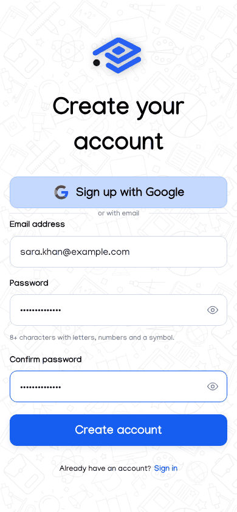

2. You see **"Check your email"**. No real email is sent. To get the link, type this in PowerShell:

   ```powershell
   python scripts/email_link.py
   ```

   It prints the link and opens it in your browser. You should see **"Email verified"**.

   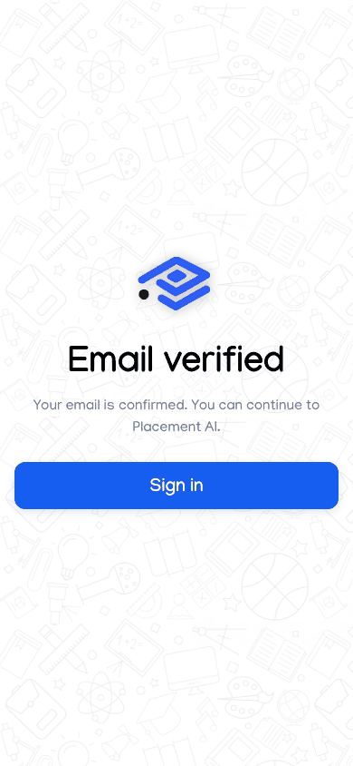

   (PowerShell only: `$c = (Invoke-RestMethod http://localhost:9099/emulator/v1/projects/demo-pai-merge/oobCodes).oobCodes | Where-Object requestType -eq VERIFY_EMAIL | Select-Object -Last 1; Start-Process "http://localhost:3000/auth/action?mode=verifyEmail&oobCode=$($c.oobCode)"`)

3. Go back to the first tab and click **I have verified my email**.

You can also click **Continue with Google**. A pretend Google window opens. Click **Add new account**, then
**Auto-generate user information**, then **Sign in with Google.com**. No real Google account is used, and no email check is needed.

### 4.2 Fill in the three short questions

- **Step 1:** first name `Sara Ahmed`, last name `Khan`.
- **Step 2:** Bachelor's, Computer Engineering, Completed, year `2020`.
- **Step 3:** date of birth 12 April 2001 (click the year, then the month, then the day), Female, city `Lahore`. Then
  click **Start with PAI**.

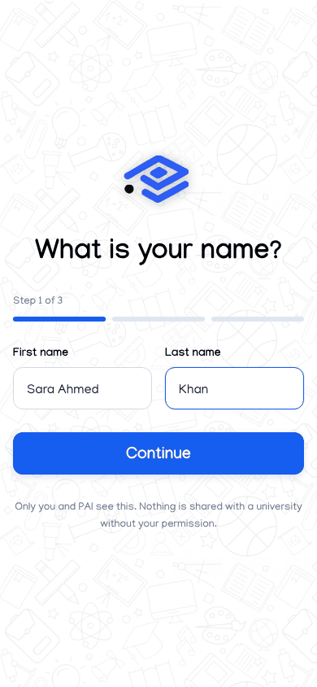 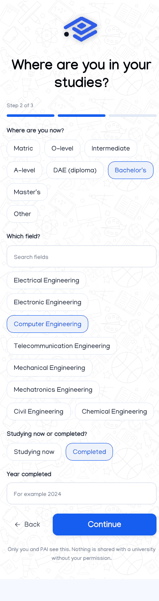 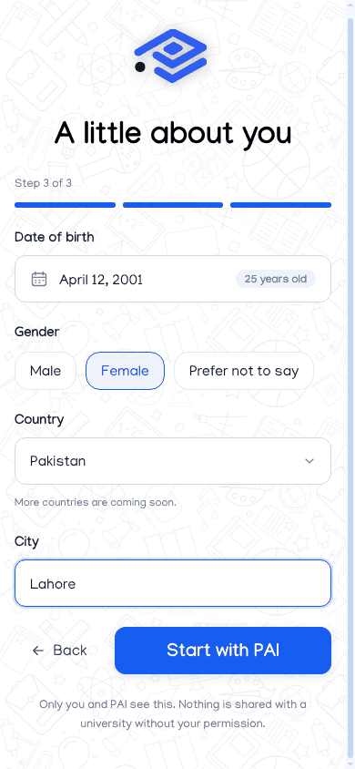

### 4.3 The Counsellor home, and finding "Study abroad plan"

You land on the Counsellor ("Hi, I am PAI"). **The chat will not answer** in this test, because there is no AI key on
purpose. You may see the typing dots for a long time. That is expected.

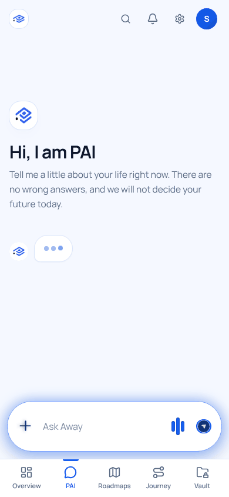

**Find the "Study abroad plan" menu:**

- **On a phone-width screen**, tap the **magnifier** (search) icon at the top. Scroll down the list to
  **Study abroad plan** and tap **Start**.
- **On a computer screen**, it is in the left sidebar under **Study abroad plan**.

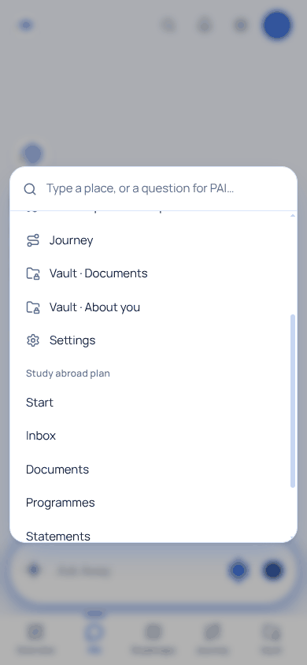 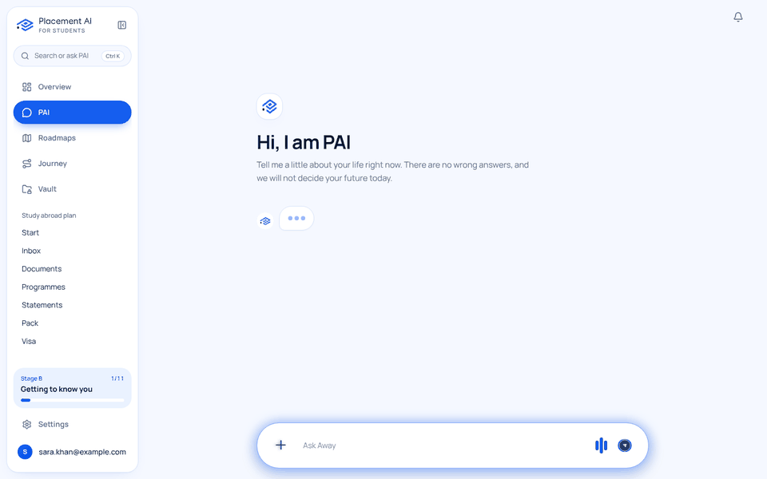

On every Study abroad plan page, the **Menu** button at the top right lists the other pages and
**Back to the main menu** (the Counsellor).

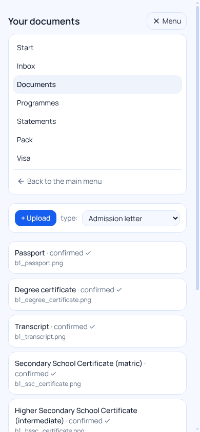

### 4.4 Consent

The **"This is a pilot"** box shows **placeholder** terms. They can be accepted only in this rehearsal set-up, never
by a real student. Click **I agree**.

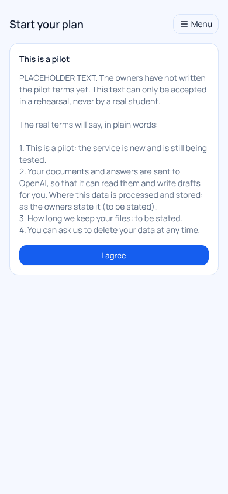

### 4.5 Start a plan

1. Leave **PK → DE · master** and intake year **2027** as they are.
2. In the list, click **Choose** on **Electrical Engineering and Information Technology (Otto von Guericke
   University Magdeburg)**, then on **Embedded Systems (TU Chemnitz)**. Most programmes show "being researched",
   because research is offline in this test.
3. Under **3. Your choices, best first**, check the order, then click **Start my plan**.

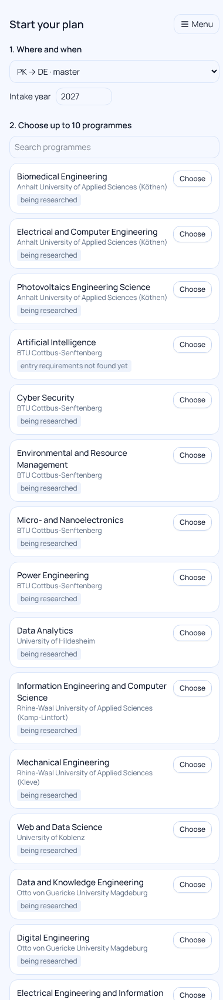 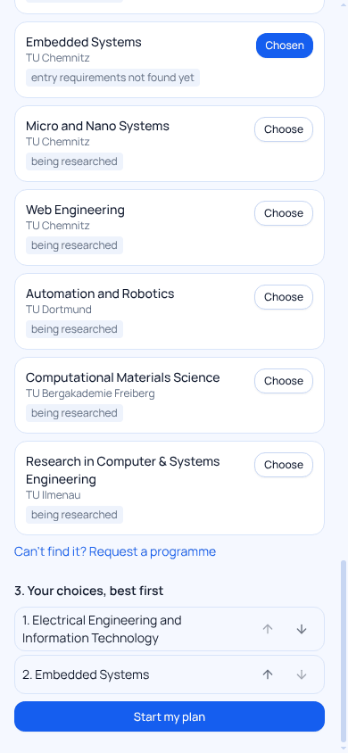

### 4.6 The inbox

The inbox ("Your next steps") opens. It lists the steps with their due dates, for example tests, uni-assist
documents, the blocked account and insurance.

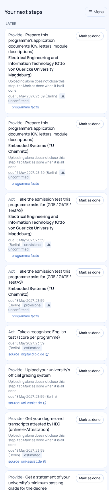

### 4.7 Upload documents

1. Open **Menu → Documents**.
2. For each of the **first seven files** in the table above: choose the **type** in the list, click **+ Upload**,
   and pick the file from `docs\local-test\sample-documents`.
3. Each one first shows "waiting to be read". A few seconds later it shows **"read: tap to check the values"**.
4. Tap each document, check the values (they come from the sample, for example `KHAN`, `SARA AHMED`, `2001-04-12`),
   and click **Confirm all**. When you are done, every document shows **confirmed ✓**.

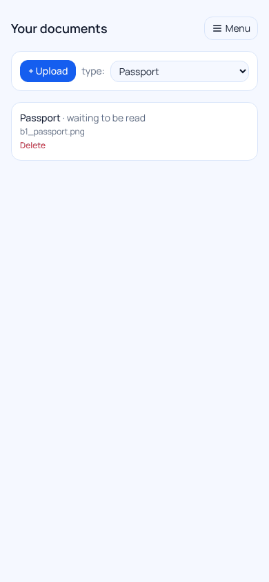 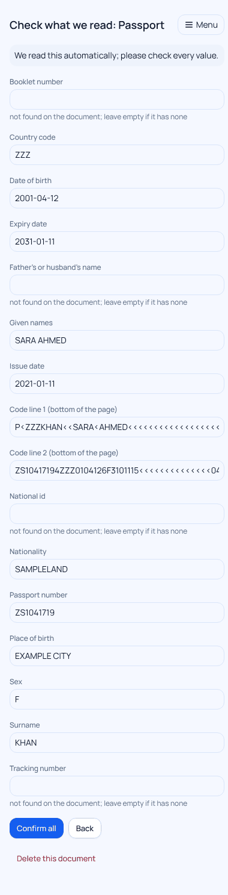 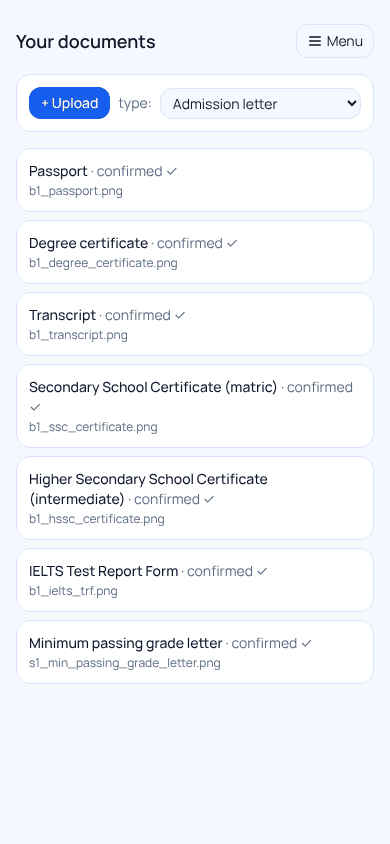

**Menu → Programmes** shows what is known about each programme. Most facts are "⚠ unconfirmed", because research is
offline.

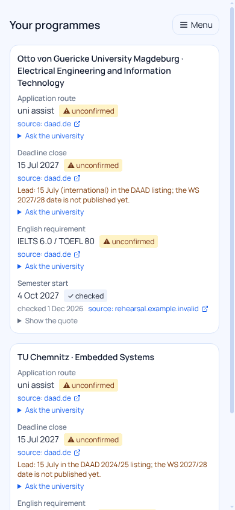

### 4.8 Statement and CV

1. Open **Menu → Statements**. Answer the questions. Short made-up answers are fine, for example "Building a small
   weather station in school started my interest in how software meets hardware." It counts **"8 of 8 answered"**,
   and answers are saved when you leave a box.
2. Click **Write my statement** and **Write my CV**. Wait a few seconds and reload. Both show **draft ready**.
3. Open each draft, read it (the offline writer mostly repeats your answers), and click **Approve this version**.
   Both now show **approved ✓**.
4. **Move the clock:** `python scripts/os_clock.py`

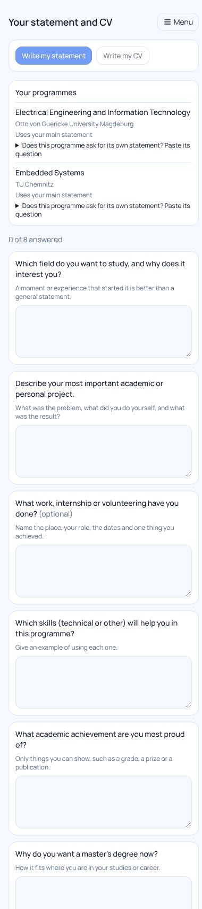 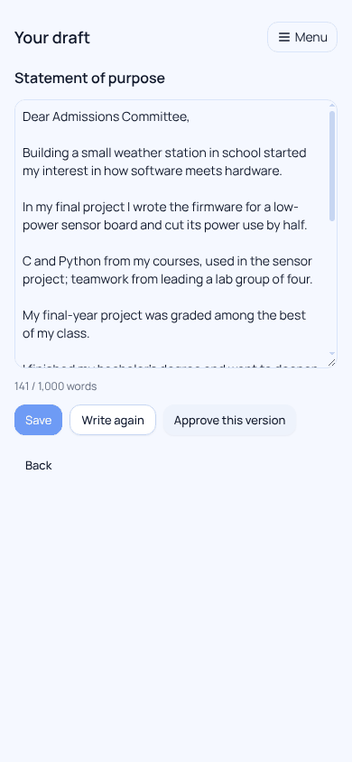 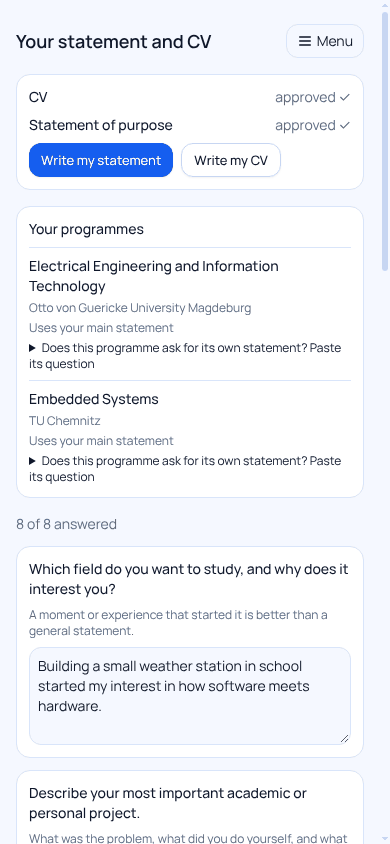

### 4.9 Funding documents, and ticking off steps

1. In **Documents**, upload `s1_blocked_account_confirmation.png` as **Blocked account confirmation** and
   `s1_insurance_certificate.png` as **Insurance certificate**. Then confirm both.
2. In **Inbox**, click **Mark as done** on each step Sara "has done": the tests, attestation, grading system,
   certificates, blocked account and insurance. **Do not** mark the "Review and approve … pack" steps as done; you
   do those on the Pack page.
3. **Move the clock:** `python scripts/os_clock.py`

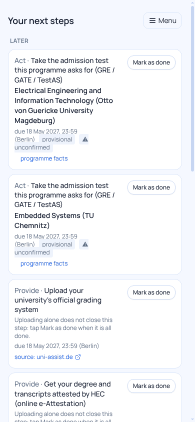

### 4.10 The application packs

1. Open **Menu → Pack**. Each programme has a pack. If it says "being prepared…", wait a few seconds and reload.
2. Open the first pack. It shows how to apply, a **Checklist** and a **Data sheet**, all filled in from the
   documents.
3. Click **A few more details**, type made-up contact details (email `sara.khan@example.com`, phone
   `+00 100 0000001`, `1 Sample Street`, `Exampleton`, `10001`, `Sampleland`), and click **Save**.
4. In the checklist, **tick** the four boxes (degree, transcript, higher secondary and secondary certificate). **Tick
   slowly, about one per second**, and check that each tick stays.
5. Click **Approve pack**. It shows **Approved ✓**. "Paid the application fee" is under "After you approve" and is
   not needed to approve.
6. Click **Back to all packs** and do the same for the second pack. Both now show **approved ✓**.
7. **Move the clock:** `python scripts/os_clock.py`

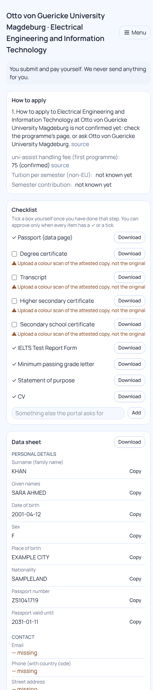 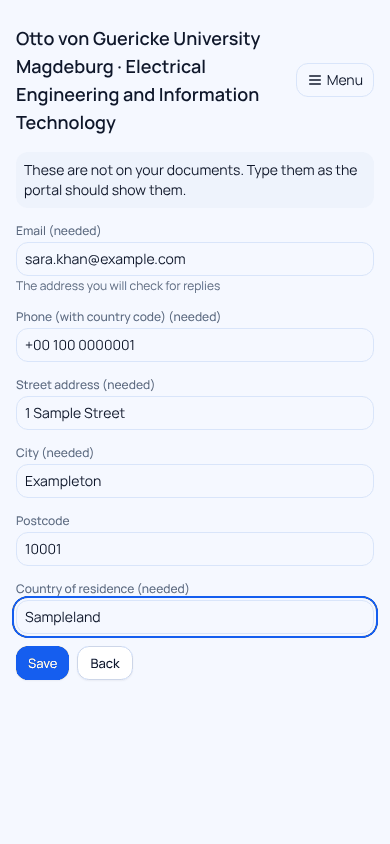 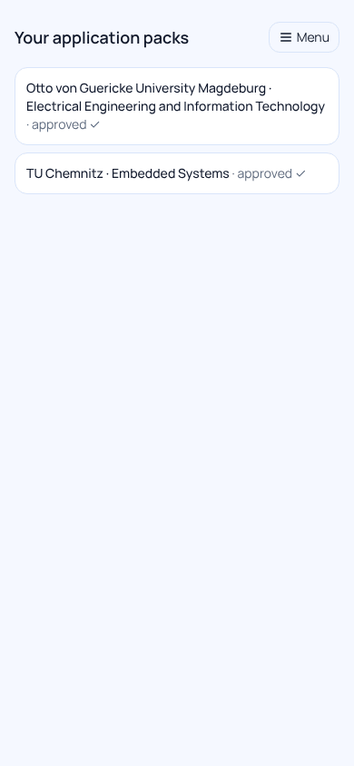

### 4.11 Submit, then the admission results

1. In **Inbox**, **"Submit the uni-assist application and pay the handling fee"** appears for each programme (ready
   to submit). Click **Mark as done** on both.
2. **Move the clock 2 days:** `python scripts/os_clock.py 2`
3. Reload the inbox. **"Tell us this programme's admission result"** appears for each programme. Click **Admitted**
   on both. (Not tried in our check: you can also try **Not admitted** on one. After the next clock move, the plan should
   suggest a change under "What changed".)
4. **Move the clock:** `python scripts/os_clock.py`. "Your plan was updated" cards appear; click **OK**.

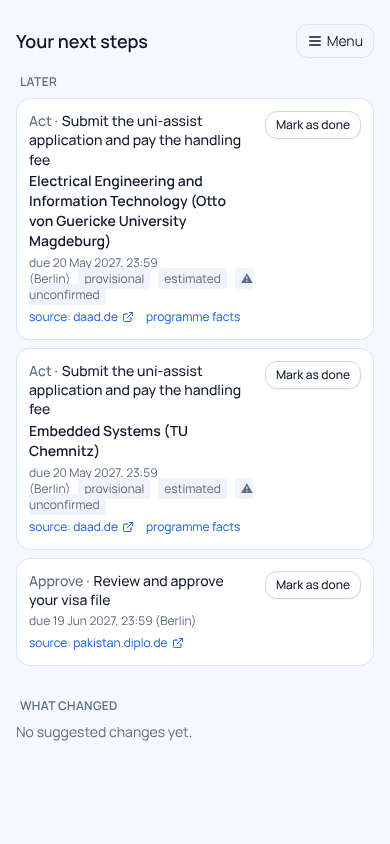 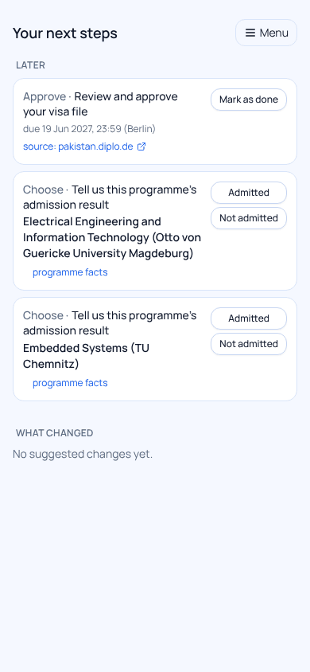 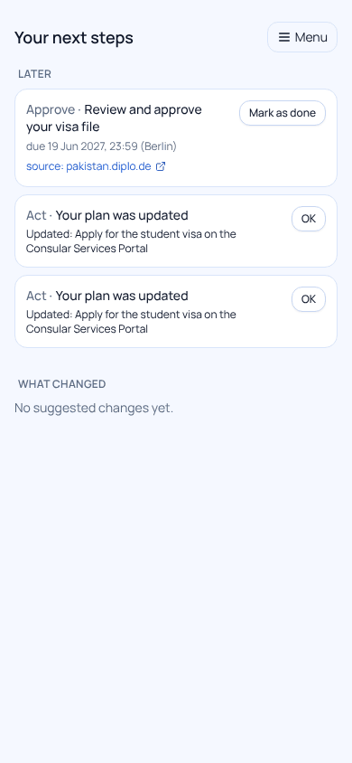

### 4.12 The visa file

1. In **Documents**, upload `s1_admission_letter_ovgu-eeit.png` as **Admission letter** and confirm it.
2. Open **Menu → Visa**. In **"Choose the programme your visa is for"**, pick **Otto von Guericke University
   Magdeburg**. Wait a few seconds and reload. The visa checklist and data sheet appear.
3. Tick the two boxes (degree certificate, transcript) and click **Approve visa file**. It shows **Approved ✓**.
4. **Move the clock:** `python scripts/os_clock.py`
5. **Inbox** now shows **"Apply for the student visa on the Consular Services Portal"**, due **21 June 2027**
   ("15 weeks before your semester starts on 4 October 2027"). That is the end of the main journey.

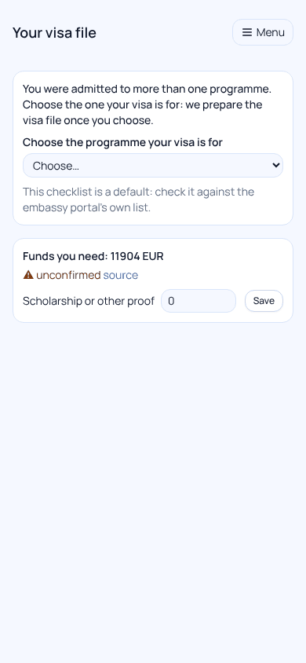 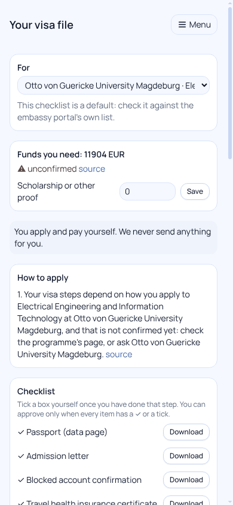 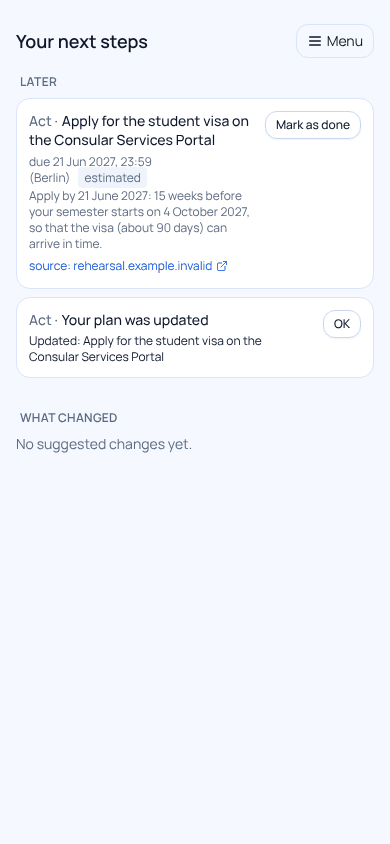

On a computer screen the same pages look like this:

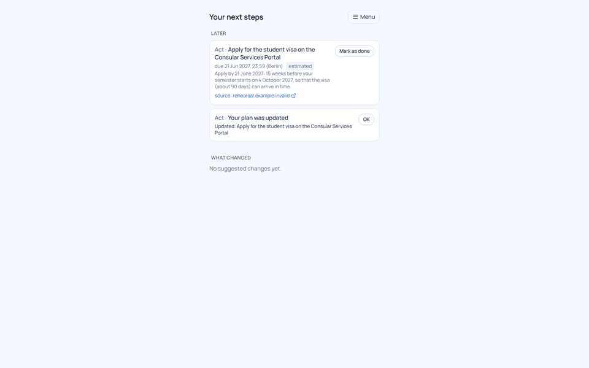 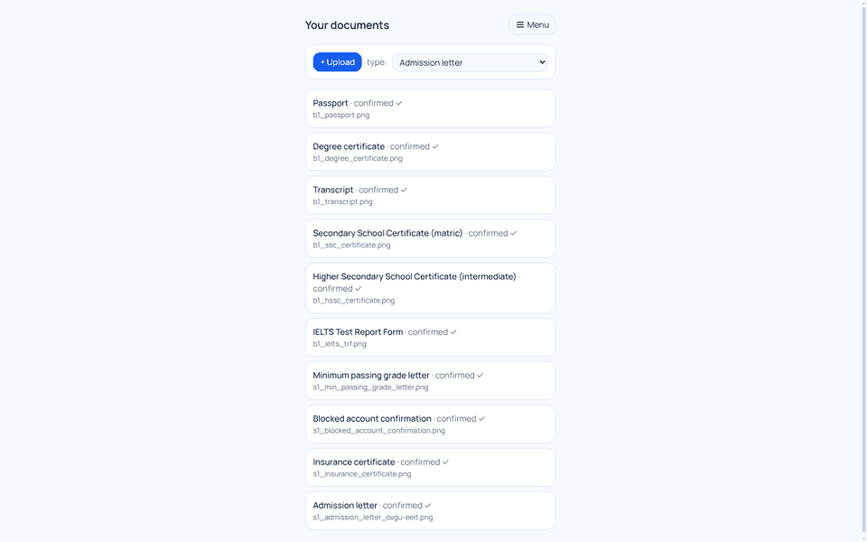

### What is expected to look odd in this test

- **The Counsellor chat does not reply.** There is no AI key, on purpose.
- **Most programme facts are "unconfirmed" or "being researched"**, because research is offline.
- **The consent text says PLACEHOLDER.** The real pilot terms are not written yet.
- **"Approved: … 10/31/2026"** and similar stamps show the real date, while the plan's dates follow the rehearsal
  clock (from 1 Dec 2026). This is by design.
- **Emails from PAI OS** are only written to the log: `docker compose logs os-worker`.

Please write down anything else that blocks you, looks wrong, or is unclear. Note the page, what you did, what you
expected and what happened, and take a screenshot.

---

## Part 5: Stop, wipe, restart

| I want to… | Type this (inside `pai-merge-test`) |
|---|---|
| **Stop** the app, keeping the account and data | `docker compose stop` (or quit Docker Desktop) |
| **Start it again** | `python scripts/run.py` |
| **Start completely fresh** (new empty database, new test accounts, clock back to 1 Dec 2026) | `python scripts/run.py --fresh` |
| **Delete everything** this test put in Docker | `python scripts/del.py` (it waits 5 seconds; press Ctrl+C to cancel) |
| **Get the newest code** for this branch | `git pull`, then `python scripts/run.py` |

`del.py` removes **only** the `pai-merge` containers, storage (database, uploads, test accounts) and images. Another
local PAI copy (for example a `pai-c` stack) is left alone. After you delete everything, the next start rebuilds the
images, so it takes longer again.

**Stop with `docker compose stop` or by quitting Docker Desktop**, not by switching off the PC while it runs. The
pretend sign-in service saves its test accounts only on a clean stop. If the accounts are lost and you sign up again
with the same email, the app stays on "Check your email". Then either use a different email, or start fresh with
`python scripts/run.py --fresh`.

---

## Troubleshooting

**"WSL 2 is not installed" or "WSL needs updating" (Docker Desktop will not start)**
Open PowerShell **as administrator**: click Start, type `PowerShell`, right-click it and choose **Run as
administrator**. Then type:

```powershell
wsl --install
wsl --update
```

Restart the PC, then open Docker Desktop again.

**"Virtualization support not detected" / "Hardware assisted virtualization … disabled"**
Open **Task Manager** (Ctrl+Shift+Esc), go to **Performance → CPU**, and look for **Virtualization: Enabled**. If it
says Disabled, you must switch it on in the PC's BIOS/UEFI:

1. Restart the PC and press the setup key while it starts. This is often **F2**, **F10**, **Del** or **Esc**; the
   maker's website says which.
2. Find **Intel Virtualization Technology (VT-x)** or **AMD SVM**, set it to **Enabled**, then save and exit.

On Windows 11 you can also open **Settings → System → Recovery → Advanced startup → Restart now → Troubleshoot →
Advanced options → UEFI Firmware Settings**.

**"Port 3000 is used by container …" or "port is already allocated"**
Something else is using 3000, 8000, 9099 or 4000. That is often another local PAI copy.

- If it is a Docker container, stop it in Docker Desktop (**Containers**, then click ■ on the other group). Then run
  `python scripts/run.py` again.
- If it is not a Docker container, find the program:

  ```powershell
  netstat -ano | findstr ":3000"
  ```

  The last number on the line is the program's ID. In Task Manager, go to **Details**, find that **PID**, and choose
  **End task**. Only do this if you know what the program is.

**"Docker is not running" / "error during connect … dockerDesktopLinuxEngine"**
Open Docker Desktop and wait for **Engine running**, then try again.

**`python` opens the Microsoft Store, or "Python was not found"**
See step 1.3: switch off the "App Installer python" aliases, or reinstall Python with **Add python.exe to PATH**
ticked. `py scripts/run.py` also works.

**The first build stops with a network error (for example "TLS handshake timeout" or "connection reset")**
Run `python scripts/run.py` again. It continues from where it stopped.

**"no space left on device"**
Free disk space. In Docker Desktop, go to **Troubleshoot** (the bug icon) and choose **Clean / Purge data**. Note that
this removes **all** Docker data, including other projects.

**Sign-in stays on "Check your email"**
Run `python scripts/email_link.py`, then click **I have verified my email**. If it still does not move on, see the
note in Part 5 about lost test accounts.

**A document stays "could not be read"**
Only the sample files, each with its matching type, can be read in this test (see the table in Part 4). Delete it
and upload it again with the right type.

**Something else is wrong**
Look at the status and the last log lines:

```powershell
docker compose ps -a
docker compose logs --tail 50 backend os-worker os-setup
```

Send those lines to the developers. They contain no secrets, because this test has none.
